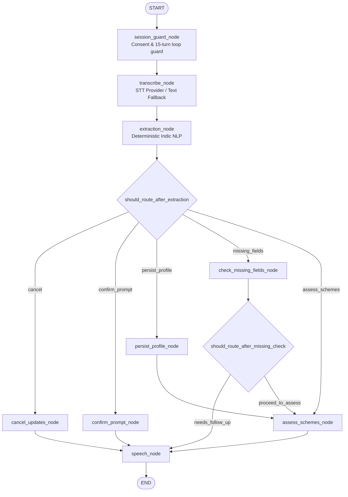

# SAHAYAK (सहायक) — Voice-First Multi-Agent AI for Government Scheme Access

**Deviathon 2.0 National Level Hackathon | GLA University, Mathura**  
**Theme:** Mission Bharat + AI Frontier  

---

## 1. Project Overview

SAHAYAK is a voice-first, multi-agent AI public-service platform designed to empower farmers, women, elderly citizens, students, and low-literacy rural citizens across India. It breaks through structural barriers—language divides, confusing eligibility criteria, complex documentation, and exploitative middleman fees—by providing an end-to-end guided journey in the citizen's native mother tongue (starting with Hindi).

### The Core Problem
- **Language & Literacy Barriers:** Most government portals (e.g., MyScheme, state portals) are text-heavy and primarily in English or formal administrative language.
- **Complex Forms & Disqualification:** Citizens often do not know which schemes match their demographic profile or how to prepare error-free applications.
- **Middleman Costs & Uncertainty:** Citizens lose time and money paying unverified intermediaries, with zero transparency into actual application readiness.

### The SAHAYAK Solution
A unified, conversational assistant driven by **6 specialized, deterministic-governed AI agents**:
1. **Voice Agent:** Indic speech-to-text (ASR) & text-to-speech (TTS) with text fallback.
2. **Profile Agent:** Progressive, respectful demographic fact collection with explicit confirmations.
3. **Eligibility Agent:** Deterministic rules engine matching verified schemes with explainable criteria.
4. **Document Agent:** Document checklist, privacy-safe OCR extraction, and citizen review.
5. **Application Agent:** Pre-filled, editable application drafts and step-by-step submission guides.
6. **Follow-up Agent:** Status tracking, honest timeline expectations, and deadline reminders.

---

## 2. Repository Layout

```text
sahayak/
├── frontend/             # React + Vite + TypeScript + TailwindCSS citizen UI
├── backend/              # FastAPI + Pydantic + SQLAlchemy + LangGraph
│   ├── app/
│   │   ├── agents/       # The 6 distinct agent definitions and LangGraph workflow
│   │   ├── api/          # REST & WebSocket endpoints
│   │   ├── core/         # Config, security, logging
│   │   ├── database/     # DB session and migrations
│   │   ├── integrations/ # Indic voice adapters, OCR, external APIs
│   │   ├── models/       # SQLAlchemy models (User, Profile, Scheme, Application, etc.)
│   │   ├── repositories/ # Data access layer
│   │   ├── schemas/      # Pydantic schemas (Agent inputs/outputs, DTOs)
│   │   └── services/     # Deterministic eligibility engine, rules validation
│   └── tests/            # Pytest test suites (unit, rules, integration)
├── docs/                 # Architectural specifications & security contracts
│   ├── architecture.md
│   ├── api-contracts.md
│   ├── privacy-and-security.md
│   └── implementation-roadmap.md
├── .env.example          # Environment configuration template
├── .gitignore            # Git exclusion rules
└── README.md             # Project documentation
```

---

## 3. Technology Stack

- **Frontend:** React 19 / TypeScript, Vite, TailwindCSS, Lucide Icons, React Router.
- **Backend:** Python 3.12+, FastAPI, Pydantic v2, SQLAlchemy 2.0 (SQLite for local dev, PostgreSQL for production).
- **AI & Orchestration:** LangGraph state machine, Provider-agnostic LLM adapter (Claude API / Anthropic SDK, with local fallback mocks).
- **Indic Voice Layer:** Modular ASR/TTS adapters (Bhashini, Sarvam AI, Whisper API, with browser Web Speech API fallback).
- **Document AI:** Vision-LLM / OCR adapter with citizen confirmation loops.
- **Testing:** Pytest (Backend), Vitest + React Testing Library (Frontend).

---

## 4. Engineering Standards & Privacy Architecture

- **Zero-Aadhaar Persistence Policy:** Full 12-digit Aadhaar numbers, biometrics, and raw identity scans are strictly barred from database and filesystem persistence; in-memory redaction filters enforce masking.
- **Deterministic Eligibility Engine:** LLMs never decide scheme qualification. Rules are executed deterministically against verified JSON/database criteria, with LLMs used exclusively for natural language explanations.
- **Honest System Status & Public Service Integrity:** No fake government approvals, application reference numbers, or simulated official stamps are ever presented to citizens.
- **Shared Device Security:** Zero PII is stored in persistent browser `localStorage`; session data remains strictly in-memory or ephemeral `sessionStorage` with instant session-wipe controls.
- **Verification Gates:** Formal alignment with DPDP Act 2023 and UIDAI guidelines is governed by explicit testable gates (Gates 6.1–6.7) to be audited prior to release.

---

## 5. Quick Start & Execution Guide (Phase 3 Active)

### 5.1 Backend Setup & Execution
1. **Install Python dependencies:**
   ```powershell
   python -m pip install -r backend/requirements.txt
   ```
2. **Start the FastAPI backend server (Port 8000):**
   ```powershell
   cd backend
   python -m uvicorn app.main:app --host 127.0.0.1 --port 8000
   ```
   *Health Check URL:* `http://127.0.0.1:8000/api/v1/health`  
   *Interactive API Docs:* `http://127.0.0.1:8000/docs`  
   *Schemes Catalogue:* `http://127.0.0.1:8000/api/v1/schemes`  
   *Voice Providers Introspection:* `http://127.0.0.1:8000/api/v1/voice/providers`

3. **Run Backend Test Suite (87 tests, 100% passing):**
   ```powershell
   python -m pytest backend/tests/ -v
   ```

### 5.2 Frontend Setup & Execution
1. **Install Node dependencies:**
   ```powershell
   npm --prefix frontend install
   ```
2. **Start the Frontend Development Server (Port 5173):**
   ```powershell
   npm --prefix frontend run dev
   ```
   *Citizen Portal:* `http://localhost:5173`  
   *Voice Assistant Interface:* `http://localhost:5173/assistant`

3. **Build Frontend for Production:**
   ```powershell
   npm --prefix frontend run build
   ```

4. **Run Frontend Tests (14 tests, 100% passing):**
   ```powershell
   npm --prefix frontend test
   ```

---

## 6. Phase 2: Verified Schemes & Deterministic Rules Engine

SAHAYAK curates **8 foundational Indian welfare schemes** checked against primary government guidelines (e.g., MoA&FW, NHA, MoRD, MoPNG, MoF, MoWCD):

| Scheme | Category | Jurisdiction | Statutory Benefit Representation | Primary Portal |
| :--- | :--- | :--- | :--- | :--- |
| **PM Kisan Samman Nidhi (PM-KISAN)** | Agriculture | Central Sector | ₹6,000 / year (Direct Benefit Transfer in 3 installments) | [pmkisan.gov.in](https://pmkisan.gov.in) |
| **Ayushman Bharat (PM-JAY)** | Healthcare | Centrally Sponsored | Up to ₹5,00,000 / year (Hospitalization Cashless Coverage) | [pmjay.gov.in](https://pmjay.gov.in) |
| **Kisan Credit Card (KCC)** | Financial Security | Central Sector | Up to ₹3,00,000 (Subsidized Credit Limit at 4% with PRI) | [myscheme.gov.in](https://myscheme.gov.in) |
| **PM Awas Yojana - Gramin (PMAY-G)** | Housing | Centrally Sponsored | ₹1,20,000 (Plain) / ₹1,30,000 (Hilly/NE/IAP) Pucca Construction Assistance | [pmayg.nic.in](https://pmayg.nic.in) |
| **PM Ujjwala Yojana (PMUY 2.0)** | Women & Child | Central Sector | ₹1,600 (Deposit-Free Connection) + ₹200-₹300 Target Refill Subsidy | [pmuy.gov.in](https://pmuy.gov.in) |
| **PM Fasal Bima Yojana (PMFBY)** | Agriculture | Centrally Sponsored | Comprehensive Crop Loss Insurance (Premium 1.5%–2% / 5% comm.) | [pmfby.gov.in](https://pmfby.gov.in) |
| **NSAP Old Age Pension (IGNOAPS)** | Social Welfare | Centrally Sponsored | ₹200 (60–79 yrs) / ₹500 (80+ yrs) + State Contribution per month | [nsap.nic.in](https://nsap.nic.in) |
| **Sukanya Samriddhi Yojana (SSY)** | Financial Security | Central Sector | Up to ₹1,50,000 / year (Deposit Limit, 8.2% Compounded, EEE Tax Free) | [nsiindia.gov.in](https://nsiindia.gov.in) |

### Deterministic Engine Guarantees
- **Zero LLM in Eligibility Decisions:** Rules are executed 100% deterministically in Python. LLMs are never allowed to decide or hallucinate qualifications.
- **4 Explicit Supported Statuses:**
  - `ELIGIBLE`: All statutory criteria satisfied, confirmed profile, zero disqualifying exclusions.
  - `POTENTIALLY_ELIGIBLE`: Criteria provisionally met; unconfirmed profile or state revenue/registry records pending.
  - `INELIGIBLE`: Statutory criteria violated or explicit exclusion triggered (e.g. income tax payer, pucca house, male applicant for PMUY).
  - `NEEDS_MORE_INFO`: Missing critical data attributes; missing fields are never defaulted to false or zero.
- **Traceable Explainability:** Each evaluation outputs satisfied criteria, failed criteria, applicable exclusions, pending statutory checks, required documents, primary citations, and next recommended actions in both Hindi and English.

---

## 7. Phase 3: Voice Agents & LangGraph Multi-Agent Orchestration

### 7.1 Architecture & LangGraph State Machine
Phase 3 establishes an end-to-end, consent-gated, Hindi-first voice assistant powered by a compiled **LangGraph** state graph (`voice_assistant_graph` in `backend/app/services/voice/graph.py`):



### 7.2 Core Guarantees & Features
1. **Zero Raw Audio Retention:** Raw citizen audio submitted to `/api/v1/voice/transcribe` or `/api/v1/voice/turn` is processed strictly in-memory. Audio byte arrays are purged in `finally:` blocks (`del audio_bytes`). No audio files are ever written to disk.
2. **Consent-Gated Voice Execution:** Sessions without affirmative consent receive `status: "awaiting_consent"` and are barred from voice processing until explicit consent is granted.
3. **Indic NLP & Negation Handling:** The deterministic Indic extractor (`DeterministicIndicExtractor`) recognizes Devanagari numerals, units, occupations, and explicit negations (e.g., *"मेरे पास पक्का मकान नहीं है"* correctly extracts `has_pucca_house = False`).
4. **Explicit Confirmation Gating:** NLP-extracted profile updates are never written directly to the database. They are held in volatile `proposed_profile_updates` and only committed after explicit citizen confirmation (*"हाँ यह सही है"* or UI confirmation button).
5. **Deterministic Engine Invocation:** Scheme recommendations within voice turns invoke `EligibilityEngine.evaluate(...)` directly for all foundation schemes, ensuring zero LLM hallucinations.
6. **Single Focused Follow-Up:** When demographic information is incomplete, the assistant asks at most ONE focused follow-up question per turn with clickable quick chips.
7. **Kiosk Wipe & Memory Purge:** Calling `POST /api/v1/sessions/terminate` wipes both SQLite citizen records and in-memory conversation state in `VoiceSessionManager`.
8. **Loop Guard:** Hard limit of 15 conversational turns per session prevents runaway loops and resource exhaustion.

