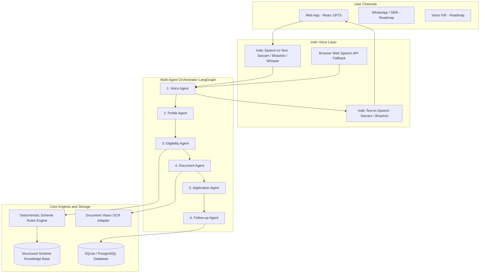
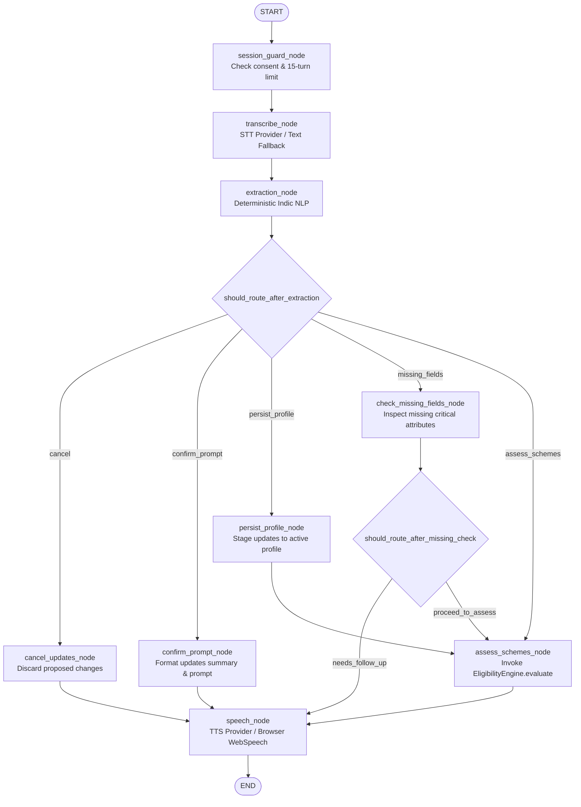
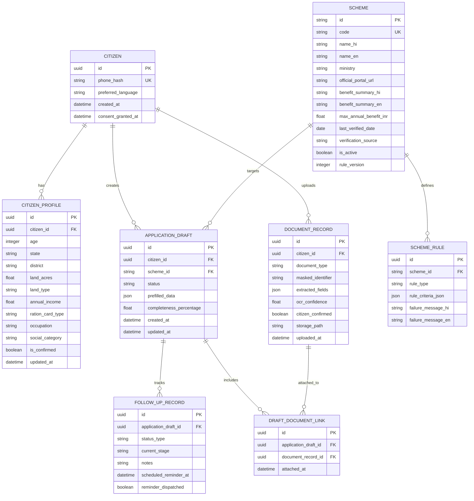

# SAHAYAK System Architecture

## 1. High-Level Architecture

SAHAYAK connects citizens directly to government welfare schemes via an intuitive, voice-first multi-agent architecture. Designed specifically for low-literacy, rural, and regional-language users, it combines Indic speech recognition, deterministic eligibility verification, intelligent document inspection, and structured follow-up.



---

## 2. Multi-Agent Orchestration (LangGraph State Machine)

Rather than an unconstrained chat loop, SAHAYAK uses **LangGraph** to enforce explicit state transitions, strict validation guards, and human confirmation checkpoints.

### State Schema (`VoiceGraphState`)
Implemented in `backend/app/services/voice/graph.py`:

```python
class VoiceGraphState(TypedDict, total=False):
    session_id: str
    citizen_id: str
    preferred_language: str
    consent_given: bool
    input_mode: Literal["voice", "text"]
    user_input_text: str | None
    audio_bytes: bytes | None
    audio_mime_type: str | None
    request_tts: bool
    
    # Session limits & counters
    turn_count: int
    max_turns: int
    
    # Speech-to-Text outputs
    transcript: str | None
    transcript_confidence: float
    stt_is_mock: bool
    
    # NLP & Profile extraction
    intent: str | None
    extracted_fields: dict[str, Any]
    current_profile: dict[str, Any]
    proposed_profile_updates: dict[str, Any]
    persisted_profile_updates: dict[str, Any]
    is_profile_confirmed: bool
    is_cancelled: bool
    
    # Follow-up & Missing information
    missing_fields: list[str]
    follow_up_field: str | None
    follow_up_question_hi: str | None
    follow_up_question_en: str | None
    
    # Scheme Discovery & Deterministic Assessments
    relevant_scheme_ids: list[str]
    evaluated_schemes: list[EligibilityAssessResponse]
    
    # Final Response Texts & Spoken Audio
    response_text_hi: str
    response_text_en: str
    spoken_audio_base64: str | None
    spoken_audio_format: str
    browser_tts_recommended: bool
    
    # Workflow Status
    status: Literal["ready", "awaiting_consent", "needs_confirmation", "needs_follow_up", "completed", "error"]
    error_message: str | None
    provider_info: dict[str, str]
```

### Phase 3 Compiled LangGraph State Machine




---

## 3. The Six Specialized Agents: Detailed Responsibilities & Contracts

### 1. Voice Agent (ध्वनि सहायक)
- **Primary Responsibility:** Handles real-time Indic audio input and output. Transcribes spoken Hindi/regional dialects into standardized text with confidence scores. Synthesizes empathetic, clear spoken responses in the citizen's native language.
- **Strict Boundary:** Does not store biometric voiceprints. Gracefully falls back to text chat if microphone permissions are denied, audio quality is noisy, or speech services timeout.
- **Input Contract:** Audio stream / base64 blob or raw text, target language code (`hi-IN`).
- **Output Contract:** `TranscriptResult(text=str, confidence=float, language=str, duration_sec=float)`.

### 2. Profile Agent (प्रोफ़ाइल सहायक)
- **Primary Responsibility:** Progressively discovers necessary demographic attributes:
  - Age, Gender, State, District, Rural/Urban
  - Landholding size (in Acres / Hectares / Bighas) and ownership type
  - Annual household income bracket & Ration card category (BPL, APL, Antyodaya)
  - Occupation (Farmer, Daily Wage Laborer, Artisan, Student, Unemployed)
  - Social Category (General, OBC, SC, ST, Minority) and Disability status.
- **Strict Boundary:** Asks one simple question at a time in plain language. Never collects raw Aadhaar numbers. Always requests explicit confirmation before sealing the profile.
- **Input Contract:** Raw text input from Voice Agent + current profile state.
- **Output Contract:** `ProfileUpdateResult(updated_fields=dict, missing_fields=list, is_complete=bool, confirmation_prompt=str)`.

### 3. Eligibility Agent (पात्रता सहायक)
- **Primary Responsibility:** Matches the confirmed profile against versioned, structured scheme rules in the Scheme Knowledge Base. Computes precise eligibility status:
  - `ELIGIBLE`: All mandatory conditions satisfied.
  - `POTENTIALLY_ELIGIBLE`: Key criteria met, but 1-2 non-critical details need confirmation.
  - `INELIGIBLE`: Excluded by explicit exclusion rule (e.g., income > threshold, land > 2 hectares).
- **Strict Boundary:** **The LLM NEVER determines eligibility.** Eligibility is executed by a 100% deterministic, unit-tested Python rules engine. The LLM is only utilized to generate a warm, natural explanation of the matching rules in the citizen's mother tongue.
- **Input Contract:** Confirmed `CitizenProfile` + scheme filter criteria.
- **Output Contract:** `EligibilityEvaluation(scheme_id=str, status=EligibilityStatus, benefit_summary=str, matched_criteria=list, failed_criteria=list, missing_criteria=list, plain_language_explanation=str)`.

### 4. Document Agent (दस्तावेज़ सहायक)
- **Primary Responsibility:** Generates the exact document checklist for the selected scheme. Processes uploaded camera photos or PDFs using OCR (Vision-LLM adapter). Extracts key fields (Name, DOB, Land Khatauni/Khasra number, Income certificate date).
- **Strict Boundary:** Flags low-contrast or blurred uploads immediately. Never auto-saves OCR-extracted data without citizen verification. Masks any detected 12-digit Aadhaar numbers immediately.
- **Input Contract:** Uploaded file bytes/path + expected document type (`ration_card`, `kisan_credit_passbook`, `caste_certificate`, `income_certificate`).
- **Output Contract:** `DocumentVerificationResult(doc_type=str, is_valid=bool, confidence=float, extracted_fields=dict, issues=list[str], requires_citizen_confirmation=bool)`.

### 5. Application Agent (आवेदन सहायक)
- **Primary Responsibility:** Compiles the confirmed profile and verified document references into a standardized, pre-filled application draft. Formats the data according to the scheme's official portal structure. Provides a printable / downloadable PDF/JSON summary and clear step-by-step instructions for final submission (e.g., at Gram Panchayat, CSC Center, or official portal).
- **Strict Boundary:** Never claims that the scheme has been officially submitted or approved by the government unless an authorized government API integration is active and verified. Clearly marks drafts as "Citizen Prepared Draft".
- **Input Contract:** Confirmed `CitizenProfile` + selected `Scheme` + verified `DocumentList`.
- **Output Contract:** `ApplicationDraftResult(draft_id=str, scheme_id=str, prefilled_form_data=dict, readiness_score=float, step_by_step_submission_guide=list[str], printable_summary_url=str)`.

### 6. Follow-up Agent (फॉलो-अप सहायक)
- **Primary Responsibility:** Tracks application lifecycle milestones. Sets reminders for scheme deadlines, document renewal dates (e.g., annual income certificate validity), or expected disbursement cycles (e.g., PM-Kisan 4-monthly installments).
- **Strict Boundary:** Clearly separates three status categories:
  1. *Citizen-Reported Status* (e.g., "Citizen marked as submitted at CSC on Oct 20")
  2. *Simulated/Demonstration Status* (clearly labeled during hackathon testing)
  3. *Official Retrievable Status* (only when government API endpoints are legitimately integrated).
- **Input Contract:** Application draft ID + citizen tracking updates.
- **Output Contract:** `FollowUpTimeline(application_id=str, status_category=StatusCategory, current_stage=str, next_action_date=datetime, reminders=list[Reminder])`.

---

## 4. Deterministic Rules Engine Architecture

To eliminate LLM hallucinations in critical welfare access, SAHAYAK enforces a strict separation of concerns:

```
[ Citizen Profile ] ---> [ Deterministic Rules Evaluator (Python) ] <--- [ Structured Scheme Rules (JSON/DB) ]
                                      |
                                      v
                             [ Evaluation Result ]
                           (criteria_passed, failed, benefit)
                                      |
                                      v
                       [ LLM Explainer (Claude / Llama) ]
                                      |
                                      v
                 [ Natural Voice/Text Explanation in Hindi ]
```

### Rule Evaluation Logic:
Every scheme defines an explicit JSON schema with mandatory inclusions and statutory exclusion criteria:
```json
{
  "scheme_code": "PM_KISAN",
  "min_age": 18,
  "required_occupation": "farmer",
  "land_holding_required": true,
  "state_applicability": "ALL_INDIA",
  "statutory_exclusions": [
    "institutional_landholder",
    "constitutional_post_holder",
    "serving_or_retired_government_employee",
    "income_tax_payer_previous_assessment_year",
    "monthly_pension_exceeding_10000",
    "registered_professional_doctor_engineer_lawyer_ca"
  ],
  "verification_status": "VERIFIED",
  "last_verified_date": "2026-09-15"
}
```
The Python evaluator tests each boolean condition deterministically:
1. Inclusions (e.g., landholder in UP) establish **potential eligibility** (`POTENTIALLY_ELIGIBLE`).
2. Mandatory exclusion checks must be evaluated and confirmed before reaching `ELIGIBLE` status.
3. If scheme verification data is outdated (`last_verified_date` > 90 days or status is `OUTDATED`/`UNKNOWN`), the citizen is warned to verify current terms at the official portal URL.
4. The LLM receives the structured evaluation output and provides a transparent, conditional explanation in the citizen's language.

---

## 5. Indic Speech & Document Vision Pipeline

### Voice Pipeline:
1. Citizen speaks into Web Audio API / WhatsApp Voice Note.
2. Web client transmits chunks to FastAPI WebSocket `/ws/voice/stream` or POST `/api/v1/voice/transcribe`.
3. Speech Adapter (Sarvam AI / Bhashini / Whisper) transcribes audio to UTF-8 text with confidence.
4. Voice Agent verifies confidence threshold ($>0.70$). If audio is garbled, it prompts the user to repeat.
5. Processed response text is synthesized by Indic TTS and streamed back to citizen.

### Document OCR Pipeline:
1. Citizen captures a document photograph (mobile camera or file picker).
2. Image preprocessing: resize, orientation correction, grayscale enhancement.
3. OCR / Vision Model extracts structured key-value pairs.
4. **Privacy Redaction Filter:** RegEx filters immediately redact any 12-digit number sequence matching Aadhaar format (`XXXX-XXXX-1234` masking).
5. Extracted details are presented in a confirmation modal: *"We read your Name as Ramesh Kumar and Land Area as 1.5 Acres. Is this correct?"*

---

## 6. Database Entity-Relationship Model



---

## 7. Dynamic Application Readiness Scoring

SAHAYAK **strictly rejects hardcoded or unconditional 100% readiness scores**. Readiness is dynamically calculated per scheme requirement:

$$\text{Readiness Score (\%)} = \left(\frac{W_{\text{fields}} \cdot N_{\text{confirmed\_fields}} + W_{\text{docs}} \cdot N_{\text{verified\_docs}}}{W_{\text{fields}} \cdot N_{\text{required\_fields}} + W_{\text{docs}} \cdot N_{\text{required\_docs}}}\right) \times 100$$

- If any mandatory document (e.g. Land Khatauni) or required attribute (e.g. Bank Account details) is missing or unconfirmed, the score explicitly reflects the deficit (e.g., 60% or 80%).
- Even at maximum score, the UI labels the state as: *"ड्राफ्ट पूर्ण — सीएससी केंद्र या पोर्टल पर जमा करने हेतु तैयार"* (*"Draft Complete — Ready for Submission at CSC or Portal"*), never as "Approved".
