# SAHAYAK Phased Implementation Roadmap

## 1. Master Phased Roadmap (Phase 0 to Phase 7)

```mermaid
flowchart LR
    P0["Phase 0: Architecture & Standards"] --> P1["Phase 1: Foundation & Citizen UI"]
    P1 --> P2["Phase 2: Scheme KB & Deterministic Rules"]
    P2 --> P3["Phase 3: Voice & 6-Agent LangGraph"]
    P3 --> P4["Phase 4: Document OCR & Validation"]
    P4 --> P5["Phase 5: Draft Application & Follow-Up"]
    P5 --> P6["Phase 6: Hardening & Testing"]
    P6 --> P7["Phase 7: Demo & Hackathon Handover"]
```

### Phase 0: Master Setup, Repository Inspection & Architecture (COMPLETED)
- **Status:** Complete & Verified
- **Deliverables:** Architectural blueprint (`docs/architecture.md`), API contracts (`docs/api-contracts.md`), privacy framework (`docs/privacy-and-security.md`), roadmap (`docs/implementation-roadmap.md`).
- **Success Criteria Met:** Zero ambiguous dependencies, verified scheme boundaries, strict DPDP Act compliance defined.

### Phase 1: Foundation, UI Shell & Core Backend Setup (COMPLETED & AUDITED)
- **Status:** Complete & Audited
- **Deliverables:** Working React 19 + TypeScript + Vite frontend, FastAPI async backend, SQLite persistence, bilingual i18n switcher (Hindi/English), session ownership guards, and kiosk wipe functionality.
- **Success Criteria Met:** 100% test pass rate across backend and frontend baseline test suites.

### Phase 2: Verified Scheme Knowledge Base & Deterministic Rules Engine (COMPLETED)
- **Status:** Complete & Verified
- **Deliverables:**
  - 8 foundational Indian welfare schemes verified against primary government guidelines (`PM-KISAN`, `PM-JAY`, `KCC`, `PMAY-G`, `PMUY`, `PMFBY`, `NSAP-OAP`, `SSY`).
  - Pure Python deterministic `EligibilityEngine` evaluating 4 distinct statuses (`ELIGIBLE`, `POTENTIALLY_ELIGIBLE`, `INELIGIBLE`, `NEEDS_MORE_INFO`).
  - Zero-LLM eligibility decisions: 100% reproducible, explainable, traceable evaluations with rule codes, primary citations, condition evaluations, exclusions, and missing info prompts.
  - Endpoints: `GET /api/v1/schemes`, `GET /api/v1/schemes/{id}`, `POST /api/v1/eligibility/assess` with `X-Session-ID` authentication and `profile_override` simulation.
  - Frontend: `SchemeDetailModal` interactive drawer, live assessment tab, category filters, and extended demographic profile form.
  - Test Suite: 27 unit tests + 5 API integration tests (41/41 total backend pass, 9/9 frontend pass).

### Phase 3: Voice-First Interaction & Six-Agent LangGraph Orchestrator
- **Objective:** Build the state machine connecting Voice, Profile, Eligibility, Document, Application, and Follow-up agents.
- **Voice Layer:** Modular adapter supporting Sarvam AI, Bhashini, Whisper, and browser Web Speech fallback.
- **Graph State:** LangGraph state machine with explicit human confirmation gates before state transitions.

### Phase 4: Secure Document Uploads & Vision-LLM OCR
- **Objective:** Camera photo/file upload pipeline with automated Aadhaar masking and citizen verification modal.
- **Processing:** Vision-LLM / Tesseract OCR adapter extracting structured fields from Land Khatauni, Ration Card, and Income Certificate.
- **Verification UI:** Side-by-side view showing the citizen the document photo and editable extracted fields for confirmation.

### Phase 5: Application Drafts, Checklist & Follow-up Tracking
- **Objective:** Generate printable/downloadable citizen application drafts with step-by-step submission checklists.
- **Features:** Dynamic readiness score calculator (computed from confirmed required fields and verified documents), printable PDF view, reminder scheduling for annual renewal and installment disbursement cycles.

### Phase 6: Security Hardening, Reliability & Integration Boundaries
- **Objective:** End-to-end integration testing, input sanitization, automated cleanup of temporary files, rate limiting, and graceful degradation during network cuts.
- **Testing:** Comprehensive test suite across rules engine, API endpoints, mock voice inputs, and DPDP/UIDAI verification gates 6.1–6.7.

### Phase 7: UI Refinement, Prototype Demonstration & Hackathon Handover
- **Objective:** Polish user experience for low-literacy citizens, prepare the live prototype walkthrough scenario (e.g., UP farmer with 2 acres undergoing progressive profile discovery, exclusion checks, conditional scheme matching, document verification, and draft preparation), and finalize submission deck.

---

## 2. External Integration Matrix

| Integration / Provider | Tier | Purpose | Actual Availability | Development & Fallback Strategy |
| :--- | :--- | :--- | :--- | :--- |
| **Local Rules Engine & KB** | **Active Core** | Deterministic eligibility evaluation & curated schemes | **Available Now** | In-repo pure Python engine + versioned JSON scheme records |
| **SQLite (Local) / PostgreSQL** | **Active Core** | Storage for profiles, drafts, and reminders | **Available Now** | Async SQLAlchemy SQLite database (`sahayak.db`) |
| **Browser Web Speech API** | **Active Core** | Client-side speech recognition & synthesis | **Available Now** | Native browser ASR/TTS in Chrome/Edge as zero-dependency fallback |
| **Local Mock Adapters** | **Local Mock** | Simulates LLM, speech, and OCR during offline testing | **Available Now** | Mock LLM provider, audio test fixtures, and synthetic document extractions |
| **Claude API (Anthropic)** | **External API** | Conversational reasoning & natural Hindi synthesis | *Requires API Key* | Configurable via `ANTHROPIC_API_KEY`; falls back to Local Mock Provider |
| **Sarvam AI / Bhashini** | **External API** | Indic ASR & TTS | *Requires API Key* | Configurable via API keys; falls back to Web Speech API or Mock Adapter |
| **Vision-LLM / Cloud OCR** | **External API** | Automated field extraction from uploaded documents | *Requires API Key* | Configurable via API keys; falls back to Synthetic OCR Mock |
| **WhatsApp / Twilio** | **Planned Roadmap** | WhatsApp voice notes & messaging channel | *Planned (No credentials)* | Responsive mobile web application with audio recorder |
| **DigiLocker / UMANG / CSC** | **Planned Roadmap** | Direct government portal filing & document pull | *Planned (Pending authorization)* | Pre-filled printable citizen draft + CSC operator checklist |

---

## 3. Major Technical Risks and Mitigation Strategies

| # | Technical Risk | Severity | Root Cause | Architectural Mitigation Strategy |
| :--- | :--- | :--- | :--- | :--- |
| 1 | **LLM Hallucinations in Eligibility** | Critical | Generative models guessing eligibility rules or benefits | **Strict separation:** Deterministic rules engine calculates eligibility; LLM is only permitted to explain the computed result. |
| 2 | **Dialect & ASR Transcription Noise** | High | Rural accents, background noise in farm/village | Implement an explicit **voice confirm-back loop** (*"We heard that you have 2 acres, is this correct?"*) + visual one-tap touch confirmation. |
| 3 | **Privacy Violation (Aadhaar Data)** | Critical | Uploading identity cards containing sensitive 12-digit Aadhaar numbers | Strict in-memory Regex redaction filter; zero Aadhaar storage; automated image deletion after draft generation. |
| 4 | **Outdated or Unknown Scheme Information** | Medium | Government scheme terms frequently update | Every scheme record includes a mandatory `last_verified_date`, `rule_version`, and link to official portal. Records with `last_verified_date` > 90 days or status `OUTDATED`/`UNKNOWN` trigger an explicit warning prompting citizen to check the official source URL. |
| 5 | **Shared Rural Device Privacy & Connectivity** | High | Kiosk shared devices and slow 2G/3G connections | **Zero PII in persistent `localStorage`**; ephemeral session memory with one-tap "End Session" wipe; lightweight mobile assets with resilient WebSocket reconnects. |
| 6 | **Unrealistic Government API Dependencies** | Medium | Assuming live write access to official govt portals | Transparent public-service design: produces pre-filled citizen draft forms with clear CSC center submission steps instead of fake "direct submit" claims. |

---

## 4. Immediate Next Steps for Phase 1

1. Create the `sahayak/` workspace structure.
2. Initialize backend with FastAPI, Pydantic, SQLAlchemy async SQLite setup, and health check.
3. Initialize frontend with React 19, TypeScript, Vite, TailwindCSS, and Lucide icons.
4. Build accessible, mobile-first bilingual layout (Hindi/English) with high contrast and voice microphone toggle.
5. Implement unit tests for backend API routing and frontend component rendering.
