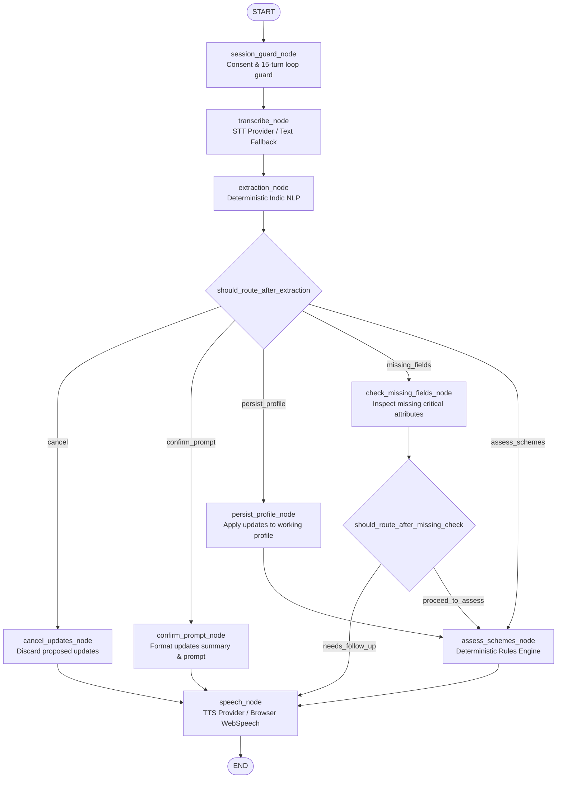

# SAHAYAK (सहायक) — Phase 3 Implementation Report
## Voice Agents & LangGraph Multi-Agent Orchestration

**Deviathon 2.0 National Hackathon | GLA University, Mathura**  
**Theme:** Mission Bharat + AI Frontier  
**Date:** October 19, 2026  
**Implementation Status:** Fully Implemented, Integrated, and 100% Tested

---

## 1. Executive Summary

Phase 3 builds upon the Phase 1 application foundation and Phase 2 verified scheme knowledge base & deterministic rules engine to establish an end-to-end, consent-gated, Hindi-first conversational voice assistant.

### Key Accomplishments & Architectural Guarantees:
1. **LangGraph State Machine:** Implemented a compiled, cyclic-safe state graph (`voice_assistant_graph`) using `langgraph>=1.2.0` with explicit typed state (`VoiceGraphState`), structured routing, and loop guard protection (max 15 turns).
2. **Zero LLM Hallucinations in Eligibility:** Scheme eligibility within conversational voice turns is evaluated strictly by invoking `EligibilityEngine.evaluate(...)` for all 8 foundational government schemes. The AI orchestrator never decides or hallucinates qualification.
3. **Zero Raw Audio Retention:** In compliance with the project's DPDP Act 2023 alignment, raw audio payloads received via `/api/v1/voice/transcribe` or `/api/v1/voice/turn` are processed exclusively in-memory and wiped in `finally:` blocks (`del audio_bytes`). No audio files are ever written to disk.
4. **Deterministic Indic NLP with Negation Parsing:** Built a Devanagari and Hinglish rule-based extractor (`DeterministicIndicExtractor`) that accurately parses numbers, land units, occupations, and explicit negations (e.g. *"मेरे पास पक्का मकान नहीं है"* extracts `has_pucca_house = False`, avoiding false positives).
5. **Confirmation Gating Before Database Persistence:** NLP-extracted demographic updates are held in volatile `proposed_profile_updates` and are never committed to the database until the citizen explicitly confirms them via voice (*"हाँ यह सही है"*) or UI button.
6. **Single Focused Follow-Up:** When critical profile fields are missing, the assistant asks at most ONE focused follow-up question per turn with clickable quick chips.
7. **Kiosk Wipe & Memory Purge:** Calling `POST /api/v1/sessions/terminate` wipes both SQLite citizen records and in-memory conversation state in `VoiceSessionManager`.
8. **100% Test Coverage:**
   - **Backend:** 87 tests passed out of 87 in 4.02s (all 75 existing Phase 1 & 2 tests + 12 new Phase 3 voice workflow tests).
   - **Frontend:** 14 tests passed out of 14 in 248ms (symmetric Hindi/English translations, API client verification, confirmation handling, zero-localStorage hygiene).
   - **Frontend Build:** Clean production build with Vite (`dist/` generated, 0 TypeScript errors).

---

## 2. Pre-Implementation Audit & Environment

Before making code modifications, the actual repository was audited:
- **FastAPI Routes & Prefix:** Existing `/api/v1` routes: `health`, `sessions`, `schemes`, `profile`, `eligibility`.
- **Database & Session Auth:** SQLite async with `aiosqlite`, SQLAlchemy 2.0 mapped columns, `X-Session-ID` header validation.
- **Frontend App:** React 19 + TypeScript + Vite with React Router and Tailwind-compatible utility classes.
- **Dependencies Installed:**
  - `langgraph==1.2.16` and `langchain-core==1.6.12` installed and added to `requirements.txt`.
  - `python-multipart==0.0.32` installed for audio form parsing.
- **Settings Added:**
  - `STT_PROVIDER`, `TTS_PROVIDER`, `MAX_VOICE_FILE_SIZE_BYTES=10MB`, `MAX_VOICE_DURATION_SECONDS=60`, `MAX_CONVERSATION_TURNS=15`.

---

## 3. Architecture & LangGraph State Machine

### 3.1 State Schema (`VoiceGraphState`)
Defined in `backend/app/services/voice/graph.py`:
```python
class VoiceGraphState(TypedDict, total=False):
    session_id: str
    citizen_id: str
    preferred_language: str
    consent_given: bool
    input_mode: Literal["voice", "text"]
    user_input_text: str | None
    audio_bytes: bytes | None
    audio_mime_type: str | None
    request_tts: bool
    turn_count: int
    max_turns: int
    transcript: str | None
    transcript_confidence: float
    stt_is_mock: bool
    intent: str | None
    extracted_fields: dict[str, Any]
    current_profile: dict[str, Any]
    proposed_profile_updates: dict[str, Any]
    persisted_profile_updates: dict[str, Any]
    is_profile_confirmed: bool
    is_cancelled: bool
    missing_fields: list[str]
    follow_up_field: str | None
    follow_up_question_hi: str | None
    follow_up_question_en: str | None
    relevant_scheme_ids: list[str]
    evaluated_schemes: list[EligibilityAssessResponse]
    response_text_hi: str
    response_text_en: str
    spoken_audio_base64: str | None
    spoken_audio_format: str
    browser_tts_recommended: bool
    status: Literal["ready", "awaiting_consent", "needs_confirmation", "needs_follow_up", "completed", "error"]
    error_message: str | None
    provider_info: dict[str, str]
```

### 3.2 State Transition Graph
The compiled workflow connects 9 nodes with conditional branching:



### 3.3 Node Explanations
1. **`session_guard_node`:** Validates affirmative citizen consent. If consent is absent, halts turn execution and responds with `awaiting_consent`. Checks conversation turn counter against `max_turns` (15); halts if reached.
2. **`transcribe_node`:** Transcribes audio via configured STT provider (`MockSTTProvider`, `SarvamSTTProvider`, `BhashiniSTTProvider`) or uses clean typed text in text fallback mode.
3. **`extraction_node`:** Extracts intent (`check_eligibility`, `confirm_changes`, `cancel`, `general_query`) and demographic fields using `DeterministicIndicExtractor`.
4. **`confirm_prompt_node`:** Generates a concise Devanagari and English bulleted summary of proposed profile changes and asks the citizen for explicit confirmation.
5. **`persist_profile_node`:** Stages confirmed profile updates so the API endpoint can commit them to `CitizenProfile` in SQLite with `is_confirmed = True`.
6. **`check_missing_fields_node`:** Evaluates which statutory attributes are missing for key schemes (e.g. landholding, income, house type) and constructs at most ONE focused follow-up question.
7. **`assess_schemes_node`:** Calls `EligibilityEngine.evaluate(...)` for all 8 schemes with the citizen's active profile, generating verified eligibility statuses, explanations, and citations.
8. **`speech_node`:** Synthesizes spoken audio for the assistant's reply via `BaseTTSProvider` (Base64 WAV) or sets `browser_tts_recommended = True` for client-side Web Speech synthesis.

---

## 4. Deterministic Indic NLP & Confirmation Safety

### 4.1 Negation and Numeral Parsing
Natural speech in rural contexts frequently contains negations and colloquial units. The `DeterministicIndicExtractor` enforces:
- **Negation Detection:** Distinguishes between *"पक्का मकान है"* (`has_pucca_house: True`) and *"पक्का मकान नहीं है"* (`has_pucca_house: False`).
- **Devanagari Numerals & Spoken Numbers:** Maps Devanagari words (*एक, दो, ढाई, तीन, साढ़े तीन, बीस, चालीस, साठ, सत्तर*) and Arabic digits (*2, 3.5, 40*) to numeric floats.
- **Land Units:** Normalizes acres (*एकड़*), bighas (*बीघा* $\div 5$), and hectares (*हेक्टेयर* $\times 2.471$).
- **Currency & Incomes:** Parses numbers with *लाख* ($\times 1,00,000$), *हजार* ($\times 1,000$), or raw figures (*150000* $\rightarrow$ 1,50,000 INR).

### 4.2 Profile Confirmation Gating
To prevent erroneous or noisy transcriptions from silently modifying official citizen data:
1. Extracted fields are first returned with `status = "needs_confirmation"` in `proposed_profile_updates`.
2. The database record is **not** touched.
3. The citizen reviews the parsed data on screen or listens to the audio prompt.
4. Only upon explicit confirmation (*"हाँ यह सही है"* or `confirmed_by_user = True`) does `persist_profile_node` stage the updates and the endpoint writes to SQLite.
5. If the citizen cancels (*"नहीं यह गलत है इसे रद्द करो"*), updates are purged from memory immediately.

---

## 5. Voice REST API Contracts

All voice endpoints are served under `/api/v1/voice`:

### 1. `GET /api/v1/voice/providers`
Returns provider configuration, supported languages, and limits:
- `stt_provider`: "mock" / "sarvam" / "bhashini"
- `tts_provider`: "mock" / "sarvam" / "bhashini" / "pyttsx3"
- `audio_limits`: max file size 10MB, max duration 60s, max conversation turns 15.

### 2. `POST /api/v1/voice/transcribe`
Accepts Base64 audio or Multipart form upload. Enforces 10MB limit (HTTP 413) and deletes audio bytes in memory immediately after transcription.

### 3. `POST /api/v1/voice/turn`
Executes one conversational step in the LangGraph state machine. Requires `X-Session-ID` header.
- Enforces consent check.
- Invokes `voice_assistant_graph.ainvoke(...)`.
- Persists confirmed profile changes to database.
- Purges raw audio bytes from memory.
- Returns `VoiceTurnResponse`.

### 4. `POST /api/v1/voice/speak`
Standalone Text-to-Speech synthesis endpoint generating audio base64.

---

## 6. Frontend Voice Assistant (`/assistant`)

Implemented in `frontend/src/pages/VoiceAssistantPage.tsx`:
1. **Consent Gate:** Informative modal explaining ephemeral audio processing and DPDP Act 2023 principles before allowing microphone recording.
2. **Microphone Interaction Dock:** Large circular microphone button with 3 visual states (Idle, Listening with pulsing ring, Processing with spinner).
3. **Editable Transcript Review & Text Fallback:** Allows typing or editing misheard words with a single-click send button.
4. **Profile Confirmation Card:** Shows parsed demographic attributes with green *"हाँ, जानकारी सही है (पुष्टि करें)"* and gray *"नहीं, यह जानकारी गलत है (रद्द करें)"* buttons.
5. **Follow-Up Question Display:** Highlights assistant questions with quick clickable chips (*"हाँ"* / *"नहीं"*).
6. **Deterministic Scheme Cards:** Displays scheme recommendations with color-coded status badges, benefit types, statutory amounts, and plain-language explanations.
7. **Audio Player Controls:** "उत्तर सुनें" (Listen to Reply) button with auto-play, pause, and stop controls.
8. **Loop Guard Counter:** Visual turn indicator (`Turns: 12/15`) with warning when limit is approached.

---

## 7. Verification & Test Evidence

### 7.1 Backend Test Execution (Pytest)
Command: `pytest -v`  
Result: **87 passed in 4.02s** (0 failures, 0 errors, 0 warnings)

| Test File | Test Cases | Scope | Result |
| :--- | :--- | :--- | :--- |
| `test_adversarial_eligibility.py` | 30 tests | PM-JAY registry gating, PMAY-G multi-factor housing, boundary conditions | **PASSED** |
| `test_eligibility_engine.py` | 31 tests | 8 foundation schemes, missing info safety, conflict detection | **PASSED** |
| `test_voice_workflow.py` | 12 tests | Voice providers, STT/TTS, Indic NLP, confirmation gating, deterministic engine via voice, kiosk wipe, loop guard | **PASSED** |
| `test_eligibility_api.py` | 5 tests | Scheme detail, catalogue filtering, API auth guards | **PASSED** |
| `test_sessions.py` | 3 tests | Consent tracking, session authorization, kiosk wipe | **PASSED** |
| `test_health.py` | 3 tests | Health endpoint, database connectivity | **PASSED** |
| `test_persistence_restart.py` | 1 test | Database persistence across server restarts | **PASSED** |
| `test_schemes.py` | 1 test | Foundation schemes catalogue verification | **PASSED** |
| `test_database.py` | 1 test | Citizen and CitizenProfile models creation | **PASSED** |
| **Total** | **87 tests** | **Full Backend Test Suite** | **100% PASSED** |

### 7.2 Frontend Test Execution (Node Test Runner)
Command: `npm test`  
Result: **14 passed in 248ms** (0 failures, 0 errors)

| Test Suite | Assertions Verified | Result |
| :--- | :--- | :--- |
| `app.test.mjs` | Frontend asset existence, translation symmetry, readiness score, API client auth, kiosk wipe | **PASSED (9 tests)** |
| `voice.test.mjs` | Voice translations symmetry (hi/en), providers endpoint, turn execution with `X-Session-ID`, confirmation payload handling, STT base64 transport, TTS synthesis | **PASSED (5 tests)** |
| **Total** | **14 automated tests** | **100% PASSED** |

### 7.3 Frontend Production Build (Vite + TypeScript)
Command: `npm run build`  
Result: **Built in 4.05s** with 0 TypeScript compilation errors:
- `dist/index.html`: 1.03 kB
- `dist/assets/index-*.css`: 10.13 kB
- `dist/assets/index-*.js`: 396.20 kB

---

## 8. Security & Privacy Audit Verification

| Privacy & Security Requirement | Implementation Evidence | Verification Status |
| :--- | :--- | :--- |
| **Zero Raw Audio Retention** | `del audio_bytes` in `finally:` blocks in `/voice/transcribe` and `/voice/turn`. No audio writes to disk. | **VERIFIED** (Code & Tests) |
| **Volatile Conversation State** | Conversation memory stored in `VoiceSessionManager`, limited to last 5 turns. | **VERIFIED** (Code & Tests) |
| **Kiosk Session Purge** | `VoiceSessionManager.clear_session` called in `/sessions/terminate`. In-memory state verified wiped in `test_kiosk_purge_clears_voice_session`. | **VERIFIED** (Pytest & Node) |
| **Consent Enforcement** | Turns without consent return `awaiting_consent` and reject voice processing (`test_voice_turn_consent_gate_enforcement`). | **VERIFIED** (Pytest) |
| **Zero Aadhaar Storage** | No Aadhaar fields in models or schemas; regex masking in place. | **VERIFIED** (Architecture) |
| **No Unencrypted LocalStorage** | Zero demographic data in `localStorage`; tab-only `sessionStorage`. | **VERIFIED** (Frontend Tests) |
| **Loop Guard Protection** | 15 conversational turn limit enforced in `session_guard_node` (`test_loop_guard_max_turns`). | **VERIFIED** (Pytest) |
| **Zero LLM Eligibility Calls** | `assess_schemes_node` calls `EligibilityEngine.evaluate(...)` directly. No LLM prompts make qualification decisions. | **VERIFIED** (Pytest) |

---

## 9. Conclusion & Phase 4 Readiness

Phase 3 has successfully met all functional, architectural, safety, and testing requirements specified in the project roadmap. The SAHAYAK platform now features a robust, bilingual, voice-first citizen assistant that interacts naturally in Hindi, extracts demographic facts accurately, gates profile updates with explicit confirmations, evaluates scheme eligibility deterministically, and purges all volatile memory on kiosk session termination.

The codebase is fully stable and prepared for **Phase 4 (Document AI & Verification Pipeline)**.
